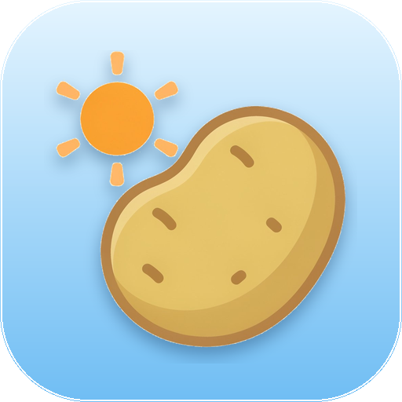
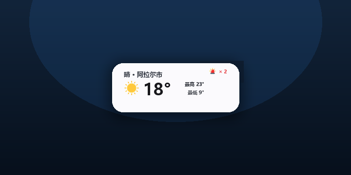
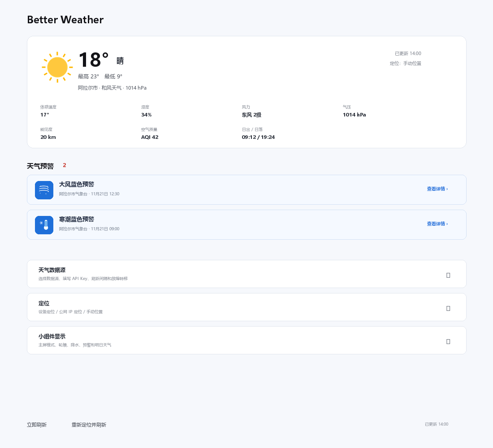

<div align="center">


# 更好的天气 · Better Weather for CW2

面向 **Class Widgets 2** 的多数据源天气插件：支持实时天气、自动定位、内容轮播、明日天气、逐小时预报、降水预报和天气预警。

[](https://github.com/Sweet-Potato-t/Better-Weather-for-CW2/releases)
[](LICENSE)
[](https://github.com/Sweet-Potato-t/Better-Weather-for-CW2/releases)

> 本项目使用 DeepSeek V4.1 Flash 编写，由口天一大化石提供独家 Token 支持。
</div>


## 简介

**更好的天气（Better Weather for CW2）** 是一个面向 **Class Widgets 2** 的多数据源天气小组件。它支持和风天气、小米天气、Open-Meteo、wttr.in、MET Norway、OpenWeatherMap、WeatherAPI、彩云天气、腾讯天气、高德天气和中央气象台（NMC），既可以使用设备定位或公网 IP 自动获取位置，也可以手动搜索城市或输入经纬度。

小组件在主屏显示当前天气，并按设置轮播明日天气、未来 3 小时、降水预报和天气预警。迷你模式只显示主屏；隐藏时还可以在 5 秒后自动清空内容并停止轮播。

---

## 功能

### 小组件

- **主屏**：天气图标、当前温度、天气现象、当日最高/最低温；可在“实时温度”和“最高/最低温”之间切换。
- **多屏轮播**：当前天气 → 明日天气（到达设定时段后）→ 未来 3 小时 → 降水预报 → 天气预警。
- **主屏摘要**：天气图标下方显示预警/降水摘要；预警使用通用预警图标和 `× N` 数量，可在设置中关闭。
- **迷你模式**：只保留当前天气主屏，不生成其他屏幕，也不启动轮播。
- **昼夜图标**：使用当天日出、日落时间判断昼夜；并兼容和风天气的昼/夜图标代码。
- **降水预报**：显示“多久后开始/停止”，例如“10 分钟后有雨”“25 分钟后雨停”；支持雨/雪区分。
- **天气预警**：独立预警屏幕显示预警类型、等级和发布时间，多条预警逐条轮播。
- **明日天气时段**：可设置每天开始/结束时间，仅在时段内显示明日天气屏幕。
- **隐藏时空白屏幕**：小组件隐藏 5 秒后清空内容并停止轮播；重新显示时恢复天气和轮播，可在设置中关闭。
- **空白屏幕暂停自动更新**：空白屏幕生效期间停止定时天气请求；重新显示后恢复并更新，可单独关闭。
- **点击刷新**：点击小组件立即刷新天气。
- **自适应定位**：设备定位（Windows 位置服务、Qt Positioning） 和公网 IP 多层回退。
- **故障转移**：当前数据源失败时，可按设置尝试其他可用数据源。




### 设置页

打开 **Class Widgets 2 → 设置 → 插件 → Better Weather**：

- **当前天气与预报**：体感温度、湿度、风力、气压、能见度、空气质量、日出日落和逐日预报。
- **天气预警**：每条预警一张卡片，点击可查看完整预警详情。
- **天气数据源**：选择数据源、填写 API Key、刷新间隔、请求超时、故障转移，以及数据源能力表。
- **定位**：分别开关设备定位和公网 IP 定位；显示定位状态；可手动搜索城市或输入经纬度。
- **小组件显示**：主屏模式、主屏摘要图标、明日天气时段、未来 3 小时、降水、轮播、主屏停留时长、切换动画、隐藏时空白屏幕、空白屏幕暂停自动更新、温度单位等。
- **关于**：插件版本、GitHub 仓库、致谢。



---

## 数据源能力

| 数据源 | ID | 需要 Key | 当前 | 明日 | 3 小时 | 降水 | 预警 |
| --- | --- | :---: | :---: | :---: | :---: | :---: | :---: |
| Open-Meteo | `open-meteo` | 否 | ✓ | ✓ | ✓ | ✓ | — |
| 小米天气 | `xiaomi` | 否 | ✓ | ✓ | ✓ | — | ✓ |
| 中央气象台（NMC） | `nmc` | 否 | ✓ | ✓ | — | — | ✓ |
| wttr.in | `wttr` | 否 | ✓ | ✓ | ✓ | ✓ | — |
| MET Norway | `met-no` | 否 | ✓ | ✓ | ✓ | — | ✓ |
| 和风天气 | `qweather` | 是 | ✓ | ✓ | ✓ | ✓ | ✓ |
| 高德天气 | `amap` | 是 | ✓ | ✓ | — | — | — |
| 腾讯天气 | `tencent` | 是 | ✓ | ✓ | ✓ | — | ✓ |
| OpenWeatherMap | `openweathermap` | 是 | ✓ | ✓ | ✓ | ✓ | ✓ |
| WeatherAPI | `weatherapi` | 是 | ✓ | ✓ | ✓ | ✓ | ✓ |
| 彩云天气 | `caiyun` | 是 | ✓ | ✓ | — | — | ✓ |

> 实际能力以数据源当前接口为准。中央气象台使用官网公开页面数据，不是正式开发者 API，接口可能随官网调整。
>
> 和风天气已迁移到 v1 实时、每日和小时接口；预警使用 `/weatheralert/v1/current/{lat}/{lon}`，分钟降水使用 `/v7/minutely/5m`。需要控制台分配的专属 API Host。

---

## API Key 安全

需要 Key 的数据源，其 API Key 使用 **Windows DPAPI**（当前 Windows 用户上下文）加密后保存在 Class Widgets 配置中。

- 配置文件中保存的是 `dpapi:` 密文，不是明文。
- 设置页不会回填明文，只显示“已加密保存”。
- 输入新 Key 才会替换旧值。
- 旧版本的明文 Key 会在首次加载时自动迁移为密文。
- DPAPI 密文绑定当前 Windows 用户；换用户或换电脑后需要重新填写。

---

## 定位说明

默认自动定位顺序：

1. **Windows 位置服务**：优先通过 `Windows.Devices.Geolocation` 请求系统定位。
2. **Qt Positioning**：Windows 位置服务失败时，尝试 Class Widgets 2 自带的 Qt 定位源。
3. **公网 IP 定位**：仍失败时，依次尝试 `ipwho.is`、`ipapi.co`、`api.ip.sb`、`ipinfo.io`、`ip-api.com`。
4. **反向地理编码**：通过 BigDataCloud / Nominatim 获取城市名称。

设备定位需要在 Windows 中允许桌面应用访问位置：

**设置 → 隐私和安全性 → 位置 → 允许桌面应用访问你的位置**

自动定位可以完全关闭；关闭后只使用手动选择的位置，不会发起定位请求。公网 IP 定位通常只能到城市级，精度低于设备定位。

---

## 安装


方式一：
- 在“插件广场”中安装并启用本插件。
- 重启 Class Widgets 2。
- 在小组件编辑界面添加 **Better Weather** 小组件。


方式二：
- 关闭 Class Widgets 2。
- 下载最新的 `com.sweetpotato.weather-vX.Y.Z.cwplugin`。
- 打开 Class Widgets 2 → 设置 → 插件，导入插件包。
- 重启 Class Widgets 2，在插件列表中启用 **Better Weather**，然后再次重启 Class Widgets 2。
- 在小组件编辑界面添加 **Better Weather** 小组件。

---

## 使用

### 小组件

添加小组件后会自动读取插件设置并刷新天气。默认主屏显示天气图标、温度、天气现象和最高/最低温。

- 开启“未来 3 小时”后，有逐小时数据时加入小时屏幕。
- 有降水时加入降水预报屏幕；有多条预警时逐条显示。
- 开启“明日天气”并到达设定时段后，加入明日天气屏幕。
- 开启“迷你模式”后只显示主屏。
- 点击小组件立即刷新。

### 设置页底部

- **立即刷新**：重新获取天气。
- **重新定位并刷新**：重新执行设备定位/公网 IP 定位并刷新。

---

## 隐私与网络

插件只会在启用并添加小组件后发起网络请求：

- 天气请求会把经纬度发送给所选天气服务。
- 自动定位会请求 Windows 位置服务或第三方 IP 地理定位服务。
- 城市搜索会把搜索词发送到 Open-Meteo Geocoding 或 Nominatim。
- API Key 只发送给对应天气服务，不会写入日志或发送到其他地址。


---

## 兼容性

- Class Widgets 2 插件 API：`>=0.4.2,<0.8`
- Python：3.9+
- Qt：Class Widgets 2 自带的 PySide6
- 无额外 Python 运行时依赖
- Windows 位置服务需要 Windows 10/11 和 PowerShell 5.1

主要文件：

```text
com.sweetpotato.weather/
  cwplugin.json
  main.py                    # CW2 插件入口、QObject 后端
  cwweather/                 # 与 Qt 无关的天气核心
    config.py
    service.py               # 数据源选择、故障转移、定位编排
    location.py              # IP 定位、反向地理编码、城市搜索
    models.py
    mappings.py
    providers/
  assets/qml/
    WeatherWidget.qml        # 小组件
    WeatherSettings.qml      # 设置页
  assets/icons/              # 天气与预警图标
  assets/windows_location.ps1 # Windows 位置服务
  tools/generate_icons.py
```

---

## 已知限制

- 小米天气、wttr.in、MET Norway、NMC 等使用第三方或官网公开接口，可能限流或变更。
- 预警能力因数据源而异，备用数据源可能没有预警。
- 公网 IP 定位通常只能到城市级。
- Windows 位置服务需要系统权限；被禁用时会回退到 Qt 定位或公网 IP。
- 降水预报的时间精度取决于数据源；分钟级数据仅部分数据源提供。

---

## 致谢

- [Class Widgets SDK](https://github.com/Class-Widgets/class-widgets-sdk)
- [Class Widgets 插件模板 V2](https://github.com/Class-Widgets/plugin-template-v2)
- 所有天气数据服务及其开放接口

---

## 许可证

MIT，见 [LICENSE](LICENSE)。

本项目是第三方插件，与 Class Widgets、各天气数据服务商均无隶属关系。
