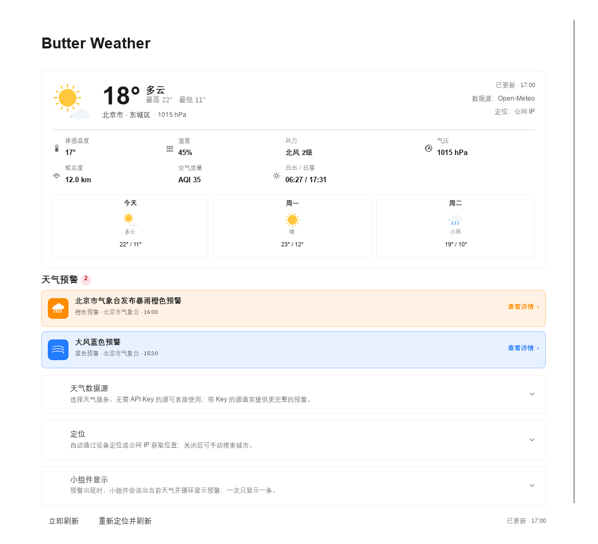
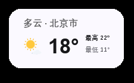
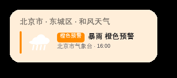
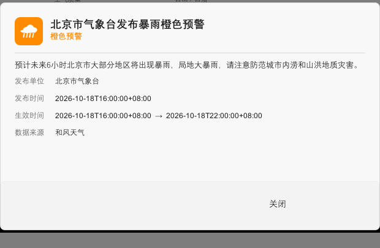

# Butter Weather for CW2

**Butter Weather for CW2** 是一个面向 **Class Widgets 2** 的多数据源天气小组件。它使用
[Class Widgets 2 SDK](https://github.com/class-widgets/class-widgets-sdk) 编写，
项目结构参考了 [插件模板 V2](https://github.com/Class-Widgets/plugin-template-v2)。

仓库：<https://github.com/Sweet-Potato-t/Butter-Weather-for-CW2>



## 功能

- **多天气源**：和风天气、小米天气、Open-Meteo、wttr.in、MET Norway、
  OpenWeatherMap、WeatherAPI、彩云天气。
- **免 Key 数据源**：Open-Meteo、小米天气、wttr.in、MET Norway 无需 API Key
  即可直接使用。
- **小组件**：显示当前天气图标、当前温度、天气现象、当日最高/最低温度。
- **天气预警**：收到预警后淡出当前天气，改为逐条循环显示预警图标、级别和
  简要信息；一次只显示一条。淡入淡出动画可以关闭，默认开启。
- **轮播间隔可调**：以秒为单位，默认 3 秒。
- **刷新间隔可调**：以分钟为单位，默认 15 分钟。
- **自动定位**：支持设备定位（Qt Positioning）与公网 IP 定位，设备定位失败
  时自动回退到 IP；自动定位可以关闭。
- **手动位置**：关闭自动定位后，可以搜索城市，也可以直接输入经纬度。
- **完整设置页**：Class Widgets 2 的“设置 → 插件 → Butter Weather”中包含当前天气详情、
  逐日预报、预警卡片和全部插件设置。点击每条预警卡片可打开该条预警的独立
  详情对话框。
- **故障转移**：当前数据源失败时，可以自动尝试其他可用数据源，避免小组件
  空白。
- **无第三方运行时依赖**：网络请求使用 Python 标准库 `urllib`，不需要安装
  `requests`、`aiohttp` 等包。

| 天气 | 预警轮播 |
| --- | --- |
|  |  |



## 数据源

| ID | 名称 | 需要 Key | 预警 | 说明 |
| --- | --- | --- | --- | --- |
| `open-meteo` | Open-Meteo | 否 | 否 | 全球覆盖，速度快，默认数据源 |
| `xiaomi` | 小米天气 | 否 | 是 | 小米天气 App 同款非官方接口，仅中国大陆 |
| `wttr` | wttr.in | 否 | 否 | WWO 数据，部分地区速度较慢 |
| `met-no` | MET Norway | 否 | 是 | 挪威气象局开放数据，全球预报；预警覆盖以其服务范围为准 |
| `qweather` | 和风天气 | 是 | 是 | 中国城市与官方预警较完整；免费订阅通常使用 `devapi.qweather.com` |
| `openweathermap` | OpenWeatherMap | 是 | 是 | One Call 3.0；免费账号可能需要单独订阅 |
| `weatherapi` | WeatherAPI | 是 | 是 | 全球覆盖，免费额度适合个人使用 |
| `caiyun` | 彩云天气 | 是 | 是 | 中国地区分钟级降水与预警能力较好 |

> 预警能力取决于数据源本身。Open-Meteo 和 wttr.in 不提供预警；如果你的主要
> 需求是预警，请选择和风天气、小米天气、MET Norway、OpenWeatherMap、
> WeatherAPI 或彩云天气。

### 关于小米天气

小米天气接口是 MIUI/HyperOS 天气客户端使用的非官方接口。插件会先通过
`wtr-v3/location/city/geo` 把经纬度解析为 `weathercn:<城市代码>`，再请求
`wtr-v3/weather/all`。该接口可能随时变化或停止服务，因此插件把它当作可失败
的数据源，并默认启用故障转移。它只支持中国大陆坐标。

### 关于和风天气

在 [dev.qweather.com](https://dev.qweather.com/) 创建项目并获取 API Key。免费
订阅通常使用默认 Host `devapi.qweather.com`；商业订阅可改为
`api.qweather.com`。插件使用经纬度查询，因此不要求填写城市 ID。

## 安装

### 方式一：导入 `.cwplugin`

1. 关闭 Class Widgets 2。
2. 下载 [com.sweetpotato.weather.cwplugin](release/com.sweetpotato.weather.cwplugin)，然后在“设置 → 插件”中导入。
3. 重启 Class Widgets 2，在插件列表中启用“Butter Weather”。
4. 在小组件编辑界面中添加“Butter Weather”小组件。

### 方式二：直接复制目录

把整个 `com.sweetpotato.weather` 目录放到 Class Widgets 2 的外部插件目录中，
确保目录内直接包含 `cwplugin.json`、`main.py` 和 `assets/`，然后重启程序。

## 使用

### 小组件

添加“Butter Weather”小组件后，它会自动读取插件设置并开始刷新。没有预警时显示：

- 当前天气图标
- 当前温度
- 天气现象
- 当日最高/最低温度
- 可选的位置和数据源标题

存在预警时，当前天气会淡出，改为显示预警摘要；多条预警会按设置的间隔循环。

### 设置页

打开 **设置 → 插件 → Butter Weather**：

- **上半部分**：当前天气详情、体感温度、湿度、风力、气压、能见度、空气质量、
  日出日落、未来几天预报。
- **天气预警**：每条预警一张卡片，点击“查看详情”打开该条预警的独立详情。
- **天气数据源**：选择数据源、填写 API Key、设置刷新间隔、请求超时和故障转移。
- **定位**：开关自动定位、选择自动定位方式、查看设备定位状态；关闭自动定位
  后可搜索城市或输入经纬度。
- **小组件显示**：淡入淡出动画、预警轮播间隔、是否显示位置/数据源、温度单位。
- **底部**：立即刷新、重新定位并刷新。

## 定位说明

默认定位流程：

1. 如果系统提供 Qt Positioning 定位源，先请求设备定位。
2. 设备定位超时、没有权限或系统未提供定位源时，回退到公网 IP 定位。
3. 公网 IP 定位依次尝试 `ipwho.is`、`ipapi.co`、`api.ip.sb`、`ipinfo.io`、
   `ip-api.com`。
4. 通过 BigDataCloud / Nominatim 反向地理编码得到城市名称。

自动定位可以完全关闭。关闭后，插件只使用设置页中选择的城市或经纬度，不会
发起定位请求。

设备定位依赖 Class Widgets 2 运行环境中的 `PySide6.QtPositioning` 模块和操作
系统定位权限。如果不可用，设置页会显示原因，并自动使用公网 IP。

## 隐私与网络

插件只在你启用并添加小组件后发起网络请求：

- 天气数据请求会发送经纬度到所选天气服务。
- 自动定位会请求第三方 IP 地理定位服务。
- 城市搜索会把搜索词发送到 Open-Meteo Geocoding 或 Nominatim。
- API Key 保存在 Class Widgets 2 的插件配置文件中，不会发送给所选服务以外的
  地址。

没有遥测、广告或后台统计。若你不希望发送位置，请关闭自动定位并手动选择城市。

## 兼容性

- Class Widgets 2 插件 API：`>=0.4.2,<0.8`（当前 SDK 为 0.7.x）。
- Python：3.9+。
- Qt：Class Widgets 2 自带的 PySide6。
- 无第三方 Python 运行时依赖。

## 开发

```bash
# 语法检查
python -m compileall .

# 重新生成图标（可选，需要 Pillow）
python tools/generate_icons.py

# 打包（需要安装 class-widgets-sdk 开发依赖）
cw-plugin-pack
```

主要文件：

```text
com.sweetpotato.weather/
  cwplugin.json
  main.py                 # CW2 插件入口、QObject 后端
  cwweather/              # Qt 无关的天气核心
    config.py
    service.py            # 数据源选择、故障转移、定位
    location.py           # IP 定位、反向地理编码、城市搜索
    models.py
    mappings.py
    providers/
  assets/qml/
    WeatherWidget.qml     # 小组件
    WeatherSettings.qml   # 插件设置页
  assets/icons/           # 天气与预警图标
  tools/generate_icons.py
```

## 已知限制

- 小米天气、wttr.in、MET Norway 的接口/服务由第三方提供，可能限流或变更。
- 预警能力因数据源而异；备用数据源可能没有预警。
- 公网 IP 定位通常只能定位到城市级，精度不如设备定位。
- 设备定位需要操作系统授权；部分系统/打包环境可能没有 Qt Positioning 插件。
- 图标为插件自带 PNG，因此不依赖主题图标库中是否存在特定天气图标。

## 致谢

- [Class Widgets SDK](https://github.com/class-widgets/class-widgets-sdk) 与
  [插件模板 V2](https://github.com/Class-Widgets/plugin-template-v2)
- [Open-Meteo](https://open-meteo.com/)、[MET Norway](https://www.met.no/)、
  [wttr.in](https://wttr.in/)、[和风天气](https://www.qweather.com/)、
  [OpenWeatherMap](https://openweathermap.org/)、
  [WeatherAPI](https://www.weatherapi.com/)、[彩云天气](https://www.caiyunapp.com/)
- 图标由本项目的 `tools/generate_icons.py` 生成

## 许可证

MIT，见 [LICENSE](LICENSE)。

本项目是第三方插件，与 Class Widgets、各天气数据服务商均无隶属关系。
