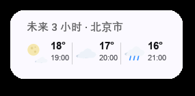
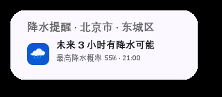

# Better Weather for CW2

**Better Weather for CW2** 是一个面向 **Class Widgets 2** 的多数据源天气小组件。它使用
[Class Widgets 2 SDK](https://github.com/class-widgets/class-widgets-sdk) 编写，
项目结构参考了 [插件模板 V2](https://github.com/Class-Widgets/plugin-template-v2)。

此插件使用Deepseek V4.1 Flash编写，由口天一大化石提供独家Token支持

## 功能

- **多天气源**：和风天气、小米天气、Open-Meteo、wttr.in、MET Norway、
  OpenWeatherMap、WeatherAPI、彩云天气。
- **免 Key 数据源**：Open-Meteo、小米天气、wttr.in、MET Norway 无需 API Key
  即可直接使用。
- **小组件主屏**：天气图标、当前温度、天气现象、当日最高/最低温度。
- **多屏幕轮播**：当前温度 → 明日天气（到设定时间后）→ 未来 3 小时（如开启）→ 降水提醒（如开启且有）→ 天气预警（如有）按顺序轮播。
- **明日天气时段**：可设置每天的开始和结束时间；在时段内加入“明日天气”屏幕，展示明日天气和最高/最低温。
- **降水提醒**：未来 3 小时降水概率较高时，加入独立的降水提醒屏幕。
- **显示模式**：主屏可切换“实时温度”或“最高 / 最低温”两种模式。
- **小组件设置集中管理**：显示模式、小时预报、降水提醒、轮播和主屏停留时长统一放在插件设置页。
- **点击刷新**：点击小组件立即刷新天气。
- **图标区分**：晴、多云、阴等天气图标已增强对比度；预警按道路结冰、沙尘暴、大风、冰雹、寒潮、霜冻等分别使用独立图标。
- **运行日志**：插件加载、刷新、设置变更、数据源失败和天气预警数量会写入 CW2 运行日志。
- **API Key 加密保存**：Windows DPAPI 加密后写入配置，设置页不回显明文；输入新 Key 才会替换。
- **精简位置名**：小组件只显示市/县/乡/镇中最小的一级；完整位置仍保留在天气数据的 `display_name` 中。
- **显示设置全局生效**：显示位置和显示天气源会应用到主屏、小时、降水和预警所有屏幕。
- **统一字号**：主屏、未来 3 小时、降水提醒和预警屏幕共用同一套标题、正文和图标尺寸。
- **官方视觉**：沿用 Class Widgets 2 的 Widget 主题背景、边框、圆角和 100px 高度；宽度由内容自适应，不再固定为 300px。
- **天气预警**：预警作为独立屏幕加入轮播，逐条显示预警图标、级别和简要信息；
  多条预警仍按预警轮播间隔逐条循环，一次只显示一条。淡入淡出动画可以关闭，默认开启。
- **停留时间可调**：主屏/小时/降水默认 8 秒，预警默认 3 秒。
- **刷新间隔可调**：以分钟为单位，默认 15 分钟。
- **自动定位**：支持设备定位（Qt Positioning）与公网 IP 定位，设备定位失败
  时自动回退到 IP；自动定位可以关闭。
- **手动位置**：关闭自动定位后，可以搜索城市，也可以直接输入经纬度。
- **完整设置页**：Class Widgets 2 的“设置 → 插件 → Better Weather”中包含当前天气详情、
  逐日预报、预警卡片和全部插件设置。点击每条预警卡片可打开该条预警的独立
  详情对话框。
- **故障转移**：当前数据源失败时，可以自动尝试其他可用数据源，避免小组件
  空白。
- **无第三方运行时依赖**：网络请求使用 Python 标准库 `urllib`，不需要安装
  `requests`、`aiohttp` 等包。
  


 

 




## API Key 安全

API Key 使用 Windows DPAPI（当前 Windows 用户上下文）加密后保存到 Class Widgets
配置中，配置文件里的值为密文。设置页只显示“已加密保存”，不会把明文回填到输入框，也不会写入日志。迁移旧版本时，首次加载会把已有的明文 Key自动转换为密文。

DPAPI 密钥绑定当前 Windows 用户；把配置复制到其他用户或电脑后需要重新填写 Key。

## 数据源

| ID | 名称 | 需要 Key | 预警 | 说明 |
| --- | --- | --- | --- | --- |
| `open-meteo` | Open-Meteo | 否 | 否 | 全球覆盖，速度快，默认数据源 |
| `xiaomi` | 小米天气 | 否 | 是 | 小米天气 App 同款非官方接口，仅中国大陆 |
| `wttr` | wttr.in | 否 | 否 | WWO 数据，部分地区速度较慢 |
| `met-no` | MET Norway | 否 | 是 | 挪威气象局开放数据，全球预报；预警覆盖以其服务范围为准 |
| `qweather` | 和风天气 | 是 | 是 | 中国城市与官方预警较完整；需要控制台专属 API Host，支持 API Key 或 JWT |
| `openweathermap` | OpenWeatherMap | 是 | 是 | One Call 3.0，使用 `appid` 查询参数；免费账号可能需要单独订阅 |
| `weatherapi` | WeatherAPI | 是 | 是 | `forecast.json`，使用 `key` 查询参数；免费额度适合个人使用 |
| `caiyun` | 彩云天气 | 是 | 是 | v2.6 Token 路径认证；官方推荐升级到 App Key/Secret 签名 |

> 预警能力取决于数据源本身。Open-Meteo 和 wttr.in 不提供预警；如果你的主要
> 需求是预警，请选择和风天气、小米天气、MET Norway、OpenWeatherMap、
> WeatherAPI 或彩云天气。

逐小时预报由 Open-Meteo、小米天气、wttr.in、MET Norway、和风天气、
OpenWeatherMap 和 WeatherAPI 提供；彩云天气的逐小时接口当前尚未接入，因此不会
出现“未来 3 小时”屏幕。没有逐小时数据时，小组件自动只显示主屏。

### 关于小米天气

小米天气接口是 MIUI/HyperOS 天气客户端使用的非官方接口。插件会先通过
`wtr-v3/location/city/geo` 把经纬度解析为 `weathercn:<城市代码>`，再请求
`wtr-v3/weather/all`。该接口可能随时变化或停止服务，因此插件把它当作可失败
的数据源，并默认启用故障转移。它只支持中国大陆坐标。

### 关于和风天气

在 [dev.qweather.com](https://dev.qweather.com/) 创建项目并获取 API Key 或 JWT。
同时在控制台设置页复制你的**专属 API Host**（例如 `abcxyz.qweatherapi.com`）。
`devapi.qweather.com`、`api.qweather.com` 等公共域名已逐步停用，插件不再默认
使用它们。插件使用经纬度查询，因此不要求填写城市 ID。

> 和风天气当前使用 v7 实时/预报/分钟降水兼容接口，天气预警使用 v1
> `/weatheralert/v1/current/{lat}/{lon}`；v7 城市天气已被官方标记为将弃用，
> 建议后续迁移到 v1 实时/预报接口。API Key 与 JWT 均已支持。

## 安装

### 方式一：导入 `.cwplugin`

1. 关闭 Class Widgets 2。
2. 下载 [com.sweetpotato.weather.cwplugin](release/com.sweetpotato.weather.cwplugin)，然后在“设置 → 插件”中导入。
3. 重启 Class Widgets 2，在插件列表中启用“Better Weather”。
4. 在小组件编辑界面中添加“Better Weather”小组件。

### 方式二：直接复制目录

把整个 `com.sweetpotato.weather` 目录放到 Class Widgets 2 的外部插件目录中，
确保目录内直接包含 `cwplugin.json`、`main.py` 和 `assets/`，然后重启程序。

## 使用

### 小组件

添加“Better Weather”小组件后，它会自动读取插件设置并开始刷新。没有预警时，
主屏显示当前天气图标、温度、天气现象和当日最高/最低温度：

- 开启“未来 3 小时”后，当前温度、未来 3 小时、降水提醒（如有）和天气预警（如有）按插件设置轮播。
- 主屏可以切换为“最高 / 最低温”模式。
- 点击小组件即可立即刷新。
- 在“设置 → 插件 → Better Weather → 小组件显示”中调整显示模式、小时预报、降水提醒、轮播和主屏停留时间。


存在预警时，预警屏幕会加入同一个轮播队列；多条预警按插件的“预警轮播间隔”
逐条循环，一次只显示一条。逐小时预报是否可用取决于数据源。

### 设置页

打开 **设置 → 插件 → Better Weather**：

- **上半部分**：当前天气详情、体感温度、湿度、风力、气压、能见度、空气质量、
  日出日落、未来几天预报。
- **天气预警**：每条预警一张卡片，点击“查看详情”打开该条预警的独立详情。
- **天气数据源**：选择数据源、填写 API Key、设置刷新间隔、请求超时和故障转移。
- **定位**：开关自动定位、选择自动定位方式、查看设备定位状态；关闭自动定位
  后可搜索城市或输入经纬度。
- **小组件显示**：主屏显示模式、明日天气及显示时间、未来 3 小时、降水提醒、轮播、主屏停留时长、淡入淡出动画、预警轮播间隔、是否显示位置/数据源、温度单位。
- **关于**：插件版本、GitHub 仓库和作者致谢；设置页还提供各天气源功能支持矩阵。
- **底部**：立即刷新、重新定位并刷新。

## 定位说明

默认定位流程：

1. 如果系统提供 Qt Positioning 定位源，先请求设备定位。
2. 设备定位超时、没有权限或系统未提供定位源时，回退到公网 IP 定位。
3. 公网 IP 定位依次尝试 `ipwho.is`、`ipapi.co`、`api.ip.sb`、`ipinfo.io`、
   `ip-api.com`。
4. 通过 BigDataCloud / Nominatim 反向地理编码得到城市名称。

自动定位可以完全关闭。关闭后，插件只使用设置页中选择的城市或经纬度，不会
发起定位请求。

设备定位依赖 Class Widgets 2 运行环境中的 `PySide6.QtPositioning` 模块和操作
系统定位权限。如果不可用，设置页会显示原因，并自动使用公网 IP。

## 隐私与网络

插件只在你启用并添加小组件后发起网络请求：

- 天气数据请求会发送经纬度到所选天气服务。
- 自动定位会请求第三方 IP 地理定位服务。
- 城市搜索会把搜索词发送到 Open-Meteo Geocoding 或 Nominatim。
- API Key 保存在 Class Widgets 2 的插件配置文件中，不会发送给所选服务以外的
  地址。

没有遥测、广告或后台统计。若你不希望发送位置，请关闭自动定位并手动选择城市。

## 兼容性

- Class Widgets 2 插件 API：`>=0.4.2,<0.8`（当前 SDK 为 0.7.x）。
- Python：3.9+。
- Qt：Class Widgets 2 自带的 PySide6。
- 无第三方 Python 运行时依赖。

主要文件：

```text
com.sweetpotato.weather/
  cwplugin.json
  main.py                 # CW2 插件入口、QObject 后端
  cwweather/              # Qt 无关的天气核心
    config.py
    service.py            # 数据源选择、故障转移、定位
    location.py           # IP 定位、反向地理编码、城市搜索
    models.py
    mappings.py
    providers/
  assets/qml/
    WeatherWidget.qml     # 小组件
    WeatherSettings.qml   # 插件设置页
  assets/icons/           # 天气与预警图标
  tools/generate_icons.py
```

## 已知限制

- 小米天气、wttr.in、MET Norway 的接口/服务由第三方提供，可能限流或变更。
- 预警能力因数据源而异；备用数据源可能没有预警。
- 公网 IP 定位通常只能定位到城市级，精度不如设备定位。
- 设备定位需要操作系统授权；部分系统/打包环境可能没有 Qt Positioning 插件。
- 图标为插件自带 PNG，因此不依赖主题图标库中是否存在特定天气图标。

## 致谢

- [Class Widgets SDK](https://github.com/class-widgets/class-widgets-sdk) 与
  [插件模板 V2](https://github.com/Class-Widgets/plugin-template-v2)
- [Open-Meteo](https://open-meteo.com/)、[MET Norway](https://www.met.no/)、
  [wttr.in](https://wttr.in/)、[和风天气](https://www.qweather.com/)、
  [OpenWeatherMap](https://openweathermap.org/)、
  [WeatherAPI](https://www.weatherapi.com/)、[彩云天气](https://www.caiyunapp.com/)

## 许可证

MIT，见 [LICENSE](LICENSE)。

本项目是第三方插件，与 Class Widgets、各天气数据服务商均无隶属关系。
